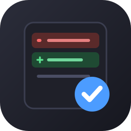
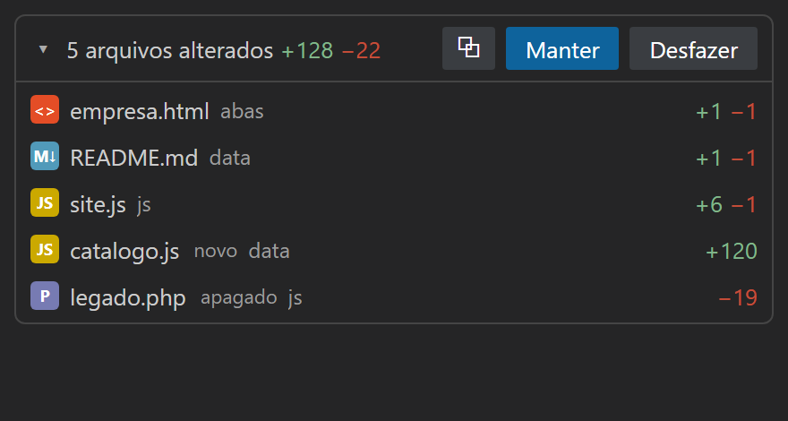
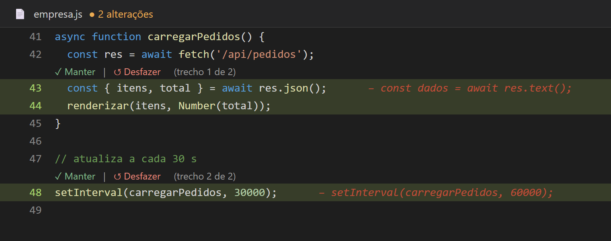
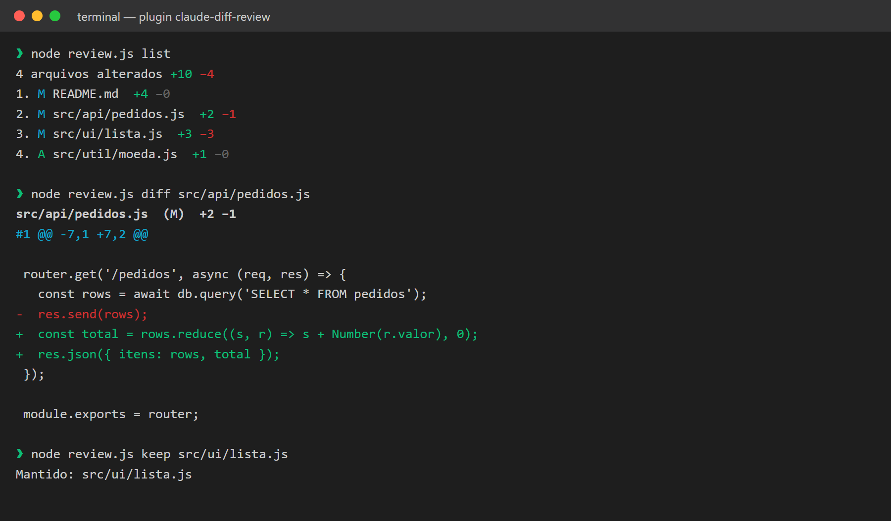

<p align="center"></p>

<h1 align="center">skill-diff-claude-code</h1>

<p align="center"><b>Revise e aprove depois as edições do Claude Code: Manter ou Desfazer por arquivo, por trecho ou tudo — no VS Code ou no terminal.</b></p>

Extensão do VS Code **Claude Review**: acumula as edições que o Claude Code (ou qualquer programa) faz nos seus arquivos, para você **revisar e aprovar depois**, no estilo do "working set" do Copilot Chat.

- **Janela de revisão** (`Claude Review: Abrir janela de revisão`, ou clique em "N edições" na barra de status): o cartão abre numa aba ao lado do editor/chat. Com `claudeReview.autoOpenWindow` ela abre sozinha na primeira edição e fecha quando tudo for resolvido.
- **Cartão de resumo** (painel lateral e janela): "N arquivos alterados +A −D", com **Manter** / **Desfazer** e um botão `⧉` que abre **todos os diffs de uma vez**.
- **Lista de arquivos** com `+N −M`; clique abre o **diff nativo** do VS Code. Passe o mouse para manter/desfazer só aquele arquivo.
- **No editor**: linhas novas em verde, texto removido em vermelho ao lado da linha, e **Manter** / **Desfazer** acima de cada trecho (CodeLens).
- **Manter tudo / Desfazer tudo**, navegação entre alterações (`Alt+F5`), atalhos `Ctrl+Alt+Enter` (manter) e `Ctrl+Alt+Backspace` (desfazer) no arquivo ativo.
- Edições pendentes sobrevivem a recarregar o VS Code.

Dica: coloque o Claude Code em modo de aceitar edições automaticamente; ele grava direto no disco e a extensão junta tudo para você aprovar depois.

## Como fica

**Cartão de revisão** (painel lateral ou janela ao lado do chat): resumo com `+` verde e `−` vermelho, **Manter**/**Desfazer** para tudo e por arquivo.

<p align="center"></p>

**No editor** — linhas novas em verde, o texto removido em vermelho ao lado, e **Manter**/**Desfazer** acima de cada trecho:

<p align="center"></p>

**No terminal** (plugin do Claude Code, sem VS Code):

<p align="center"></p>

> O cartão e o terminal são a interface real, renderizada com dados de demonstração (tema escuro padrão do VS Code). A imagem do editor é uma **ilustração** de como o realce aparece.

## Instalar com um prompt

Abra o Claude Code e cole:

```
Instale o projeto https://github.com/SEU_USUARIO/skill-diff-claude-code seguindo o INSTALL.md do repositório.
```

O Claude baixa o repositório, mostra o que vai fazer, pede sua confirmação e roda o instalador.
Depois: recarregue o VS Code (`Ctrl+Shift+P` → *Developer: Reload Window*).

### Instalar manualmente

```bash
git clone https://github.com/SEU_USUARIO/skill-diff-claude-code.git
cd skill-diff-claude-code
node install.js --dry-run   # mostra o que será feito, sem alterar nada
node install.js             # instala a extensão
```

Opções: `--build` (recompila o `.vsix`), `--editor cursor` (outro editor compatível). O instalador só roda `code --install-extension` com o arquivo de `dist/`; não altera suas configurações.

## Só Claude Code (sem VS Code)

Alternativa para quem usa apenas o Claude Code no terminal: o plugin **claude-diff-review** guarda a versão de cada arquivo antes da primeira edição do Claude (hook `PreToolUse`) e deixa você revisar depois, com "N arquivos alterados +A −D", diff verde/vermelho e Manter/Desfazer por arquivo, trecho ou tudo.

**(a) Como plugin** (dentro do Claude Code):

```
/plugin marketplace add SEU_USUARIO/skill-diff-claude-code
/plugin install claude-diff-review@skill-diff-claude-code
```

**(b) Via prompt**: peça ao Claude para instalar seguindo o `INSTALL.md`. Ele roda `node install.js --skill` e, **somente com o seu pedido ou confirmação expressa**, `node install.js --hooks` (que edita o `~/.claude/settings.json`, com backup). `node install.js --remove-hooks` desfaz.

**(c) Uso**, a partir da pasta do projeto (use o caminho da skill, ex.: `~/.claude/skills/review-edits`):

```bash
node ~/.claude/skills/review-edits/scripts/review.js list              # arquivos alterados, +N −M
node ~/.claude/skills/review-edits/scripts/review.js diff 1            # diff colorido (trechos #1, #2…)
node ~/.claude/skills/review-edits/scripts/review.js keep all          # aceita (nova linha de base)
node ~/.claude/skills/review-edits/scripts/review.js undo a.js --hunk 2  # desfaz só o trecho #2
node ~/.claude/skills/review-edits/scripts/tui.js                      # revisão interativa, num 2º terminal
```

Na interface interativa: `↑/↓` navega, `Enter`/`d` abre o diff, `n`/`p` trecho seguinte/anterior, `k` mantém, `u` desfaz (com confirmação), `a` mantém tudo, `x` desfaz tudo, `q` sai. Também existem `review.js status` (uma linha, para statusline) e `review.js json`.

Limitações: só captura `Edit`, `Write`, `MultiEdit` e `NotebookEdit` (mudanças por Bash como `sed` ou `git checkout` não entram); a linha de base começa na primeira edição vista pelo hook; binários e arquivos acima de 1 MB são ignorados. Testes: `node test/review.test.js`.

## Limitações

- Não é pixel-idêntico ao Copilot: a interface dele usa APIs internas do VS Code. Aqui usamos o editor de diff nativo, decorações e CodeLens.
- O VS Code não permite inserir linhas inteiras no editor, então o texto removido aparece em uma linha ("− texto antigo") e completo no hover e no diff.
- Rastreia **qualquer** mudança em disco no workspace (inclusive seus próprios saves e arquivos gerados). Ajuste `claudeReview.excludeDirs` para ignorar pastas.
- O estado inicial é um snapshot tirado quando o VS Code abre; arquivos não rastreados usam o `git HEAD` como base quando possível.

## Estrutura

```
extensions/claude-review/   código-fonte da extensão
dist/                       .vsix pronto para instalar
.claude-plugin/ hooks/      plugin e marketplace do Claude Code (hook de snapshot)
skills/review-edits/        skill + scripts (review.js, tui.js, snapshot.js)
test/                       testes (node test/review.test.js)
install.js                  instalador (Windows, macOS, Linux)
INSTALL.md                  instruções que o Claude segue ao instalar
```

Licença: MIT.
